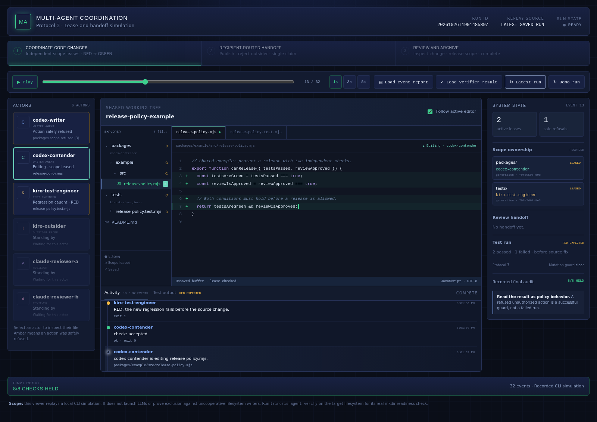

<!--
© 2026 TRINORIS. All rights reserved.
Proprietary and confidential, except for the separately licensed packages described below.
-->

# Trinoris Multi-Agent Coordination

**Safer parallel coding work when AI agents share one working tree.**

Trinoris Multi-Agent Coordination gives coding agents a lightweight way to reserve named
areas of a repository, identify who owns each reservation, and hand work to another agent
with a durable note. It is designed for teams using tools such as Codex, Claude, and Kiro
in the same checkout, where simultaneous edits can otherwise overwrite work or leave
ownership unclear.

The project uses the shared filesystem as its coordination layer. It does not require a
hosted service, message broker, or agent-specific integration to manage locks and
handoffs.

[Open the interactive replay](https://trinoris.github.io/multi-agents/) · [Run it locally](#see-parallel-coding-in-action) · [Read the CLI guide](packages/cli/README.md)

## What it helps with

- **Reduce overlapping edits.** Agents reserve agreed repository scopes before writing.
- **Make ownership visible.** Teammates can inspect active, expired, and malformed locks.
- **Make handoffs explicit.** A receiving agent claims a handoff note once, then continues
  from the recorded context, verified facts, assumptions, and next steps.
- **Recover carefully.** Expired locks can be recovered through a guarded operation that
  records an incident instead of silently removing ownership data.
- **Check the environment first.** The verifier races independent processes to confirm
  whether atomic directory creation works on the actual checkout filesystem.

## See parallel coding in action

**Watch the actors. Follow the code. Inspect the system state.**

**[Explore the simulator on GitHub Pages →](https://trinoris.github.io/multi-agents/)**

The built-in simulator runs scripted agent sessions through the real coordination CLI
in a disposable workspace. Watch a writer and test engineer hold independent scopes,
take a regression from RED to GREEN, and hand the change to a reviewer. Competing
writers and an incorrectly addressed claimant exercise the protocol's refusal paths.



| Actors | Coding workspace | System state |
| --- | --- | --- |
| See who is editing, reviewing, waiting, or refused. | Explore the file tree, switch editor tabs, and inspect changed lines and test output. | Inspect scope owners, lease generations, handoff progress, and final checks. |

Pause at an editing step, select an actor to inspect their file, or scrub backward to
restore the earlier code and ownership. **Follow active editor** tracks the next actor's
file automatically. The recorded final audit stays available alongside the replay.

Run it from a checkout with Node.js 20+ and pnpm:

```bash
pnpm install --frozen-lockfile
pnpm build
pnpm simulate
```

Then open [`simulation/viewer/index.html`](simulation/viewer/index.html) locally in your
browser. It automatically loads the latest saved run. **Demo run** provides a synthetic
preview; **Latest run** reloads newly generated results. Saved reports let you return to
an earlier run and replay it again.

The GitHub Pages site automatically publishes a fresh recorded run after default-branch
pushes and nightly. Maintainers can also run **Simulator replay · GitHub Pages** from the
Actions tab. Each published replay includes the viewer and its recorded data; the
disposable working tree stays outside the public site.

See the [simulator guide](simulation/README.md) for the scenario, controls, and verification,
or the [workspace design](simulation/docs/editor-workspace.md) for how recorded events map
to files and ownership.

## How it works

```text
Agent A                         Agent B
  |                               |
  | reserve scope: api            | inspect current ownership
  +---------------+---------------+
                  |
          shared repository
                  |
       .trinoris/ records
       ├── locks/       scope ownership and leases
       ├── handoff/     work passed between agents
       └── incidents/  guarded recovery history
```

The protocol is cooperative: agents agree to check and honor the records. Scopes are
explicit names from a repository registry, rather than file globs, so ownership conflicts
remain understandable. Locks have leases because agent processes may end between tool
calls. Before writing, an agent verifies that its identity still owns the scope. Handoff
claims and lock operations use filesystem primitives selected and tested for the target
environment.

## Designed for

- Multiple AI coding agents editing different parts of one checkout.
- A team that wants to coordinate agents without adding a server to its development
  environment.
- Work that moves between agents and needs a reviewable record of what was done and what
  remains.
- Local or shared filesystems where the verifier confirms the required atomic behavior.

It does not coordinate separate clones or branches. It cannot prevent a non-cooperating
agent, editor, or script from writing without a lock. It does not launch agents, schedule
tasks, send live notifications, or replace Git workflows. Use branch isolation or a hosted
coordination service when those capabilities or enforced access controls are required.

## Packages

| Package | Purpose |
| --- | --- |
| [`@trinoris/agent-core`](packages/core/) | Shared coordination types and core logic. |
| [`@trinoris/agent-sdk`](packages/sdk/) | Programmatic API for scopes, leases, handoffs, and guarded recovery. |
| [`@trinoris/agent-cli`](packages/cli/) | `trinoris-agent` commands for setup, verification, ownership, and handoffs. |

The CLI guide includes concrete workflows, configuration, examples, and limitations:
[`packages/cli/README.md`](packages/cli/README.md).

## Get started from source

The CLI requires Node.js 18 or later at runtime. Building and running this repository’s
release test toolchain requires Node.js 20 or later.

```bash
pnpm install --frozen-lockfile
pnpm build

# Initialize agent coordination in the repository they will share.
node packages/cli/dist/bin.js setup --work-dir /path/to/repository

# Verify the target filesystem before agents rely on scope locks.
node packages/cli/dist/bin.js verify --work-dir /path/to/repository
```

Review the generated `AGENTS.md` and `.trinoris/PROTOCOL.md`, then have every participating
agent use the same `.trinoris/` directory and follow that protocol. Setup adds the directory
to `.gitignore`. Do not rely on locks unless
verification passes for the checkout and filesystem configuration they will use.

Setup adds managed, idempotent pointers to `AGENTS.md` for Codex and `CLAUDE.md` for Claude
Code, preserving existing project instructions. Claude Code also gets a project skill at
`.claude/skills/agent-handoff/SKILL.md`.
The skill description tells Claude when to use it. Both agents follow the same protocol and
copy-ready `.trinoris/handoff/TEMPLATE.md`. Agents fill the template under
`.trinoris/handoff/drafts/`, run `trinoris-agent handoff validate`, release their scopes,
and publish with `trinoris-agent handoff publish`. The receiver follows the routed inbox,
claim, and completion steps in the same protocol; validation rejects malformed notes.

Once the CLI package is published, install it globally with:

```bash
npm install --global @trinoris/agent-cli
trinoris-agent --help
```

## Project design

- **Filesystem first:** coordination records live beside the work they govern.
- **Explicit ownership:** each lock identifies an agent instance, scope, task, and lease.
- **Verify before relying:** filesystem guarantees vary by mount and environment, so the
  CLI tests the target tree instead of assuming behavior.
- **Visible recovery:** breaking stale ownership leaves an incident record for later
  inspection.
- **Honest boundaries:** the tool makes cooperation easier to follow; it does not enforce
  cooperation or guarantee that conflicting edits are impossible.

## Learn more

- [Simulator and interactive replay](simulation/README.md)
- [Coordination protocol](specs/01-coordination-protocol.md)
- [Lock mechanism and recovery](specs/02-lock-mechanism.md)
- [Handoff format](specs/03-handoff-format.md)
- [Agent instruction entry points](specs/04-agent-entry-points.md)
- [Filesystem verification](specs/05-verification.md)
- [CLI interface](specs/06-cli-interface.md)
- [Publishing and release gate](PUBLISHING.md)

## Licensing

This repository has split licensing. The implementation packages in `packages/core`,
`packages/sdk`, and `packages/cli` are licensed under **Apache-2.0**; each package carries
the license text that ships with its npm distribution. Repository materials outside those
packages—including the specifications, architecture documents, verification suite, and
coordination records—are proprietary and are not licensed for reuse by the root
`LICENSE` file. The Apache-2.0 package license does not grant rights to the TRINORIS name
or trademarks.

See [`LICENSE`](LICENSE) for the full terms.
